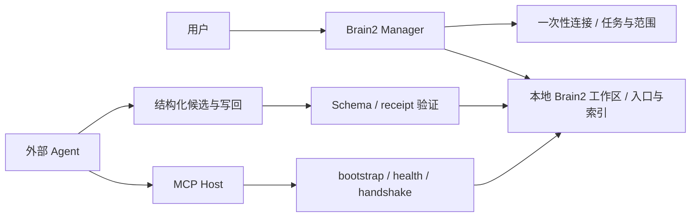

# Brain2

面向长期 AI 项目的外接上下文与受控协作体系，当前桌面产品入口是 **Brain2 Manager**。

## 为什么做 / 核心功能

长期使用多个 Agent 时，任务状态、历史决策、规则与资料散落在会话和文件中，接手时需要反复解释。Brain2 将入口、索引、上下文、项目登记和结构化回填放进可持续读取、交接、维护的本地工作区。

- 创建或接入本地记忆库；读取项目、治理入口与状态。
- 通过 Agent Adapter 和 MCP Host 完成 bootstrap、健康检查与握手，不能把“安装完成”当成“连接验证完成”。
- Agent 提交项目候选，用户决定加入、归入已有项目或忽略；用一次性任务、Schema 与 verified receipt 控制建档。
- 支持任务、事件与 Agent 工作区的结构化交接；对受控写回保留验证与回执。
- Manager 管理治理内容与连接组件；产品应用安装、更新由 Launcher 负责。这里不是一个默认接入远程模型的 RAG 聊天网站。

## 架构与真实代码



图按仓库中的真实模块整理，不是软件截图。重点入口：

| 代码 | 作用 |
|---|---|
| [main.go](main.go)、[app.go](app.go) | Manager 桌面入口与应用服务 |
| [frontend/src](frontend/src) | Vue 管理界面 |
| [internal/brain2](internal/brain2) | 记忆库、项目、任务、治理与回执机制 |
| [cmd/brain2-mcp-host](cmd/brain2-mcp-host)、[internal/agentconnect](internal/agentconnect) | MCP 接入和 Agent 配置管理 |
| [packages](packages) | Schema 与 Skill / Adapter 资源 |

## 技术与当前状态

实际使用 Go、Wails v2.11 / WebView2、Vue 3、TypeScript、Vite、本地文件与 JSON；无私人云服务依赖。源码中的产品基线是 `0.6.6 WIP`；发布预览版本可由构建参数注入，不能与源内默认版本混为一谈。仍处于产品化与预览迭代，不宣称正式商用或已具备特定用户规模。

> Brain2 Manager 与 Launcher 在原工程中共享同一个 Go module，但有独立入口、前端、进程和产品职责。两个公开仓库是同一源提交的审阅快照，保留共用代码以便复现，不宣称它们是两套互不相关、独立重写的工程。当前产品修改仍在原私有工程维护；来源与删减边界见 [SOURCE_PROVENANCE.md](SOURCE_PROVENANCE.md)。

## 如何运行与验证

阅读源码不需要私人账号或记忆库。Windows 本机构建要求 Go 1.23+、Node.js 22+、npm 与 WebView2。公开仓库不附嵌入的编译二进制，先从真实源码生成：

```powershell
powershell.exe -NoProfile -ExecutionPolicy Bypass -File scripts/prepare-public-build.ps1
go test ./...
go test -tags launcher .
go vet ./...
# 需要桌面产物时再执行现有脚本，不会自动发布：
powershell.exe -NoProfile -ExecutionPolicy Bypass -File build-split-windows.ps1
```

准备脚本只生成 MCP Host 与两套前端构建输入；未附预编译安装包、私有库或生产凭据。首次体验请使用空的测试记忆库，不要把个人知识库拷进源码仓库。实际验证与限制见 [docs/VALIDATION.md](docs/VALIDATION.md)。

## 我的职责与 AI Agent 协作

我（Shizuku）负责问题定义、需求分析、产品与交互设计、系统规则和业务逻辑、Prompt / Workflow、Agent 任务拆解，以及测试、问题复现、验收和发布迭代。代码主要由 Codex、Claude Code 等 Agent 协同生成、修复和维护；我组织推进并对产品边界和交付结果负责。这些产品原本就用于真实工作，不是为求职临时开发，也不表述为我独立手写的全栈系统。

## Meow 系列关系

- [Brain2](https://github.com/shizukuocean/brain2)：长期上下文、治理与受控 Agent 接入。
- [Dev Helper](https://github.com/shizukuocean/dev-helper-public)：规则、需求、问题证据与人工验收。
- [Meow Launcher](https://github.com/shizukuocean/meow-launcher-public)：产品目录与应用生命周期交付。
- [Meow Forge](https://github.com/shizukuocean/meow-forge-site)：独立产品展示入口；[在线查看](https://meow-forge-showcase.pages.dev/)。

## 公开与使用边界

这是可阅读、审查的真实源码展示。未为本项目自行选择 MIT、Apache 等开源许可证；公开可见不代表另行授予源码复用许可。第三方依赖仍按其各自许可证使用，见 [第三方说明](THIRD_PARTY_NOTICES.md)。这里不包含私人知识库、运行数据、Agent 凭据或未经验证的安装包。
